  

 

I build software across applied AI, backend systems, and cross-platform apps—mostly with **Python**, **TypeScript**, and **FastAPI**. Lately that has meant mapping floods from radar satellites, building Socratic code reviewers, and shipping music streaming tools.

 

### Selected Work

#### [PARALLAX](https://github.com/aadeshmax/PARALLAX)
Real-time flood and water anomaly detection platform using NASA Synthetic Aperture Radar (SAR) satellite data and computer vision to map inundation right through cloud cover.
`Python` · `Computer Vision` · `NASA SAR`

#### [codeit](https://github.com/aadeshmax/codeit)
Socratic coding mentor built with FastAPI, LangGraph, and Groq. Paste a GitHub link on the web dashboard or install the GitHub App for automated PR reviews that guide you to spot and fix issues yourself.
`TypeScript` · `FastAPI` · `LangGraph` · `Groq`

#### [resonate-app](https://github.com/aadeshmax/resonate-app)
Cross-platform music streaming and ingestion app running on React Native (Expo) and Web, backed by FastAPI and Supabase.
`JavaScript` · `React Native` · `Expo` · `FastAPI` · `Supabase`

 

### Stack

  

 

  

